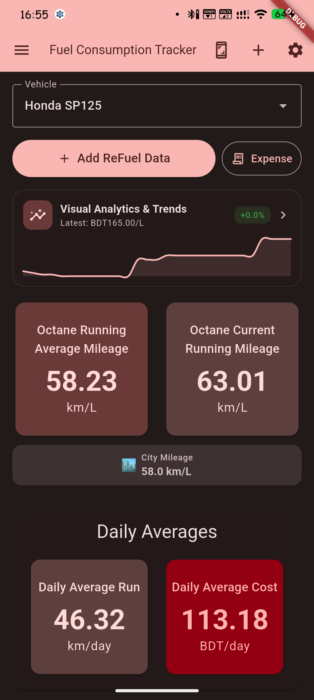
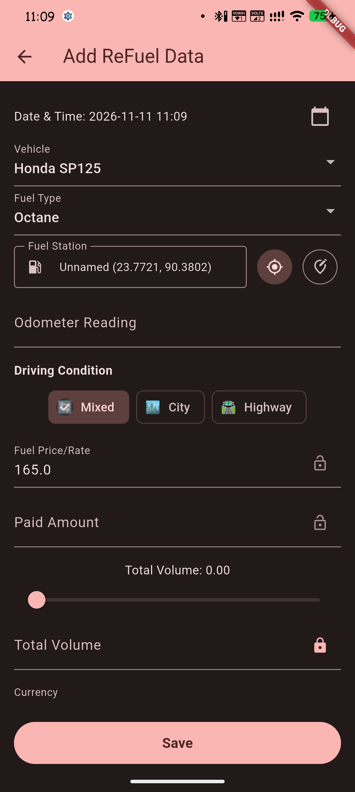
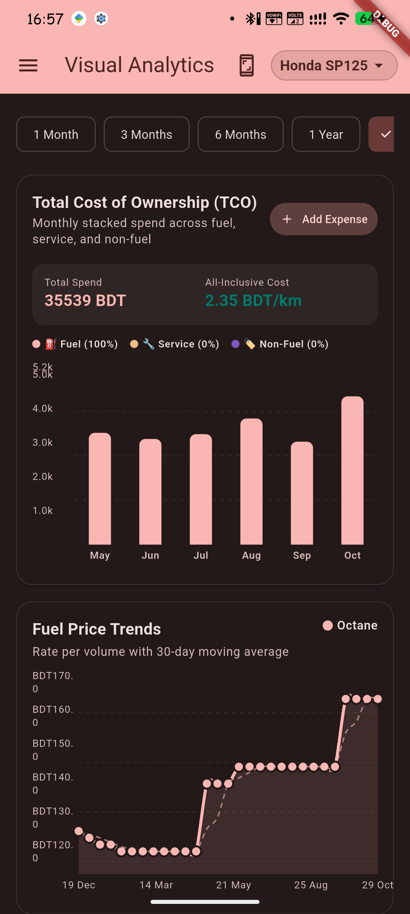
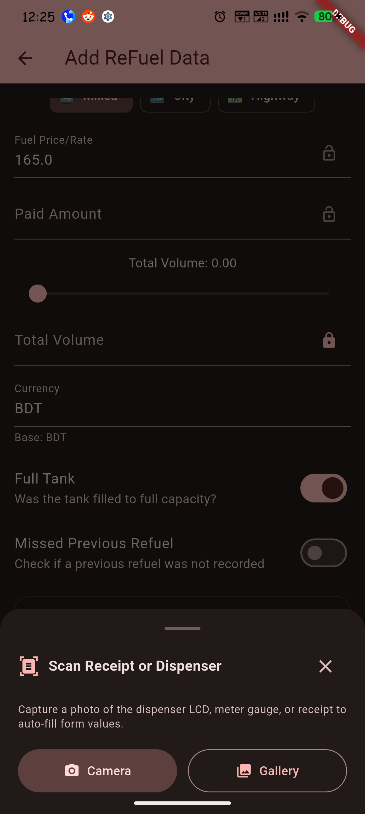
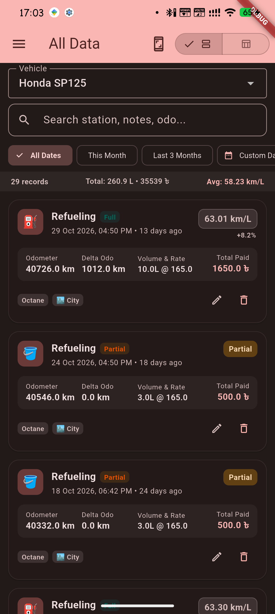
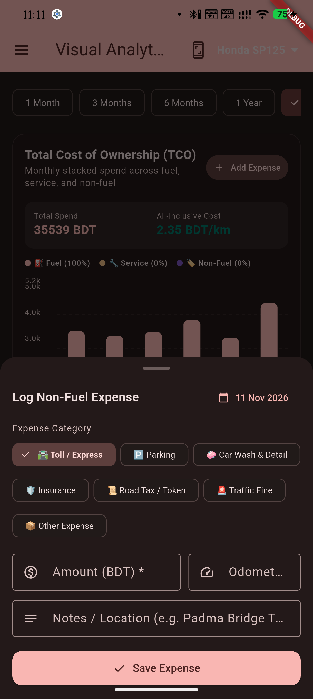
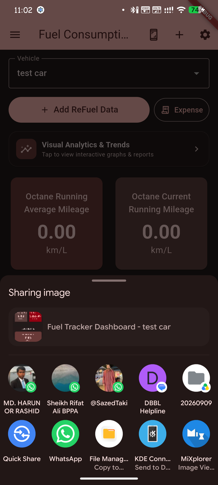

# Fuel Tracker

[](https://github.com/pollob666/fueltracker/actions/workflows/release.yml)
[](https://www.gnu.org/licenses/gpl-3.0)

Fuel Consumption tracker by **[pollob666](https://github.com/pollob666)**

A Flutter-based mobile application to help users track their vehicle's fuel consumption. The app allows users to record refueling data, view their average mileage, and monitor their fuel expenses.

## Download

You can download the latest version of the application from the [GitHub Releases](https://github.com/pollob666/fueltracker/releases) page.

## Key Features

*   **Full-to-Full Mileage Engine:** Precise consumption calculation supporting partial fills, missed fill-ups, and weighted running averages (`sum(ΔO) / sum(V)`) preventing Simpson's paradox skew.
*   **Predictive Refuel & Maintenance Reminders:** Dual refuel alerts (fuel volume and DTE range) and scheduled service reminders with Android 13/14 notification permissions (`POST_NOTIFICATIONS`, `SCHEDULE_EXACT_ALARM` with inexact fallback) and reboot/timezone persistence.
*   **Tire Life, Tread Depth & Rotation Tracker:** Interactive 4-wheel chassis schematic, `mm / 1000 km` wear degradation forecasting, 1.6mm legal limit projection, and rotation presets.
*   **Interactive Telemetry & Visual Analytics:** Fuel price trend charts with 30-day moving average smoothing, station efficiency variance scatter plots with ±15% anomaly threshold bands, and driving condition consumption breakdowns powered by `fl_chart`.
*   **Scoped OCR Receipt & Cluster Vision:** On-device text recognition with Google ML Kit, normalizing Bengali numerals (০-৯) to ASCII digits (0-9) and parsing localized comma/period thousand and decimal separators with auto-fill into refueling forms.
*   **Non-Fuel Expenses & Total Cost of Ownership (TCO):** Multi-category non-fuel expense logging (tolls, parking, maintenance, insurance, taxes) with monthly stacked cost breakdowns and printable audit-ready A4 PDF reports.
*   **Encrypted Backups & Automated Cloud Sync:** Streamed container backups (`.zip` v2 with O(1) memory), client-side AES-256-GCM / PBKDF2 encryption (`.ftbackup`), and automated periodic WebDAV background sync via WorkManager.
*   **Multi-Currency, EV & International Units:** Architectural support for ICE, Hybrid, and EV (kWh/SoC), international units (km/mi, L/gal, km/L, MPG, km/kWh), and multi-currency normalization with baseline exchange rate conversions.
*   **Dynamic Bidirectional Refuel Calculations:** Automatic calculation with intelligent lock targets (auto-calculating Volume when Rate and Paid Amount are entered, or Paid Amount when Volume is entered) and ergonomic field reordering without accidental input erasure.
*   **High-Resolution Long Screenshots:** Native in-app full-page screenshot capture and instant sharing for Dashboard, Visual Analytics, All Data History, and Maintenance screens without viewport truncation.

> For the comprehensive, detailed directory of all implemented features and technical specifications, see **[docs/features.md](docs/features.md)**.

## Screenshots

| Dashboard | Refuel Entry | Analytics & Trends | Maintenance & Tires |
|:---:|:---:|:---:|:---:|
|  |  |  |  |

| Receipt OCR | History Timeline | Non-Fuel Expenses | Long Screenshot |
|:---:|:---:|:---:|:---:|
|  |  |  |  |

## Build from Source

### Prerequisites
*   **Flutter SDK:** Version `3.47.9` (channel `stable`, Dart `3.13.7` / SDK `>=3.13.0 <4.0.0`)
*   **Java Development Kit (JDK):** Version `17` (Eclipse Temurin recommended)
*   **Android SDK:** Platform API 34+ with Android build-tools

### Build Steps

```bash
# 1. Clone repository
git clone https://github.com/pollob666/fueltracker.git
cd fueltracker

# 2. Install dependencies
flutter pub get

# 3. Verify static analysis and run unit/widget test suite
flutter analyze
flutter test

# 4. Build Android debug APK
flutter build apk --debug

# 5. Build Android release APK (requires android/app/key.properties)
flutter build apk --release
```

## Future Development Plan

The following is a roadmap of planned features to be implemented in future releases:

### Advanced Mileage & Multi-Fuel Telemetry
*   **Per-Fuel Mileage:** For bi-fuel vehicles, segregated mileage metrics calculated independently for each fuel type.
*   **Overall Blended Mileage:** Multi-fuel weighted efficiency tracking combining liquid fuel and gas / electric consumption.
*   **Cost-Efficiency Comparison:** Dynamic tracking and comparative metrics evaluating cost-per-kilometer across alternative fuel types.

## License

This project is licensed under the **GNU General Public License v3.0**. The full license text can be found in the [LICENSE](LICENSE) file.
